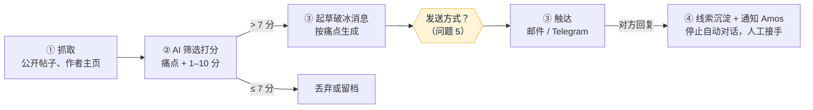

# v1 需求澄清问题：自动化客户挖掘与建联系统
- 版本：v1.0（2026-10-15）
- 角色：产品经理（PM）
- 依据：agents main `2697d91`（规则 v0.10）；Amos 在对话中给出的方案原文（四个模块：抓取 ➔ AI 筛选 ➔ 自动触达 ➔ 线索沉淀）
- 状态：等待 Amos 回答。回答之前不写《需求说明书》，不进入架构和开发（协作总则"方案先行"）。
- 变更历史：v1.0（2026-10-15）首次创建

## 一图看懂
这张图想让读者看懂：PM 对需求的理解，以及哪些环节需要 Amos 先做决定（黄色）。

## 一、PM 对需求的理解
- **目标**：为两个切入点自动找到潜在客户，筛出高价值线索，完成第一次接触；对方有回复后通知 Amos 人工跟进。
  - 切入点 A：技术 / 量化博主（TradingView 脚本作者、GitHub 量化项目作者、Telegram 信号频道），邀请参加 Prop 模式的量化挑战。
  - 切入点 B：出海商户（独立站、跨境卖家），痛点是收单出金、结汇、冻卡，推介出金对冲方案。
- **程序只做前期筛查和初次破冰**，对方表现出兴趣后由人工一对一沟通（原文"人机协同"原则）。

## 二、需要先说明的边界（PM 建议，交 Amos 裁决）
原文"避坑与风控指南"里有几项，PM 建议 **v1 不做**，原因写在下面。这几项涉及商业风险判断，按规则上报 Amos，不由 PM 自行决定。

| 编号 | 原文的做法 | PM 建议 | 原因 |
|---|---|---|---|
| B1 | 话术"脱敏"，首句避开 USDT、出金等词，躲过平台的识别 | 不做；话术如实说明身份和来意 | 这是专门绕过平台内容审核的设计。被识别后封号的是 Paypaz 的账号和域名；面向商户的金融推介内容如实表述，也是合规的基本要求 |
| B2 | 住宅代理多 IP 轮换，防止被网站封禁 | 不做；只用有公开 API 或允许抓取的来源，按对方的频率限制访问 | 绕过网站封禁违反多数网站的服务条款；被封后数据源也就断了 |
| B3 | 用个人 TG 账号（Telethon / Pyrogram）批量给陌生人发私信 | 不做批量自动发送；改为"AI 起草、人工点一下发送"，或只给公开留了商务联系方式的频道主发 | Telegram 对陌生人批量私信封号很快，也属于垃圾消息；原文的随机间隔只是延缓被发现 |
| B4 | 用浏览器脚本在论坛、TradingView 自动留言 | 不做 | 自动留言属于刷广告，违反这些平台的规则，也会伤害品牌 |

PM 建议 v1 保留的部分：从公开来源抓取 → AI 打分 → AI 起草个性化消息 → **人工确认后发送**（邮件带退订方式）→ 回复自动通知 Amos 并入库。这样的产出物和原文 ①②④ 一样，③ 只是多了一步人工确认，每天几十条的量，人工确认花不了多少时间。

## 三、澄清问题（每题附默认值，可以一句话确认）
| 编号 | 问题 | 默认值 |
|---|---|---|
| Q1 | v1 先做哪个切入点？A（量化博主）、B（出海商户），还是两个都做？ | 先做一个，跑通再加另一个；先做哪个请 Amos 指定 |
| Q2 | 第二节 B1–B4 是否同意 v1 不做？ | 同意，v1 不做 |
| Q3 | 抓取哪 3–5 个来源？ | A：GitHub（官方 API）、TradingView 公开脚本页；B：X（官方 API，需付费）、Reddit（官方 API）。AMZ123、知无不言等中文论坛，先确认服务条款允不允许抓取，再决定 |
| Q4 | 自研代码还是用 n8n / Make 低代码搭？ | 自研（Python 或 Node），因为规则要求有 CI 和测试（C54），低代码的工作流不好做版本管理和测试。如果更看重 1–2 天跑起来，可以选 n8n 先做验证版 |
| Q5 | 第 ③ 步怎么发送？ | AI 起草，在通知里给 Amos 或商务看，点"发送"后才发出 |
| Q6 | 用哪家大模型、用哪个账号？（C27：账号信息先问） | Claude API；账号、套餐请 Amos 告诉我，密钥由 Amos 自己填进平台（C21） |
| Q7 | 通知发到哪里？ | Telegram Bot，发到 Amos 的个人 TG |
| Q8 | 线索存在哪里？要不要一个网页后台看线索列表？ | v1 不做网页后台，线索存在数据库里，每天在 TG 发一份汇总；需要后台的话要先走原型确认（4.5 步） |
| Q9 | 每天大概要多少条合格线索？有没有预算上限（API、数据源费用）？ | 每天 20–50 条候选，月预算请 Amos 给一个上限 |
| Q10 | 程序部署在哪里、多久跑一次？（第五节：先确认平台） | 每天定时跑一次；平台待运维和 Amos 单独沟通 |
| Q11 | 目标客户在哪些国家和地区？抓到的个人信息保留多久？ | 只存公开帖子链接、公开的联系方式和打分结果，保留 90 天；涉及欧盟的线索按 GDPR 处理（可以要求删除） |
| Q12 | 切入点 B 的破冰话术和"冻卡包赔方案"这类承诺，谁来审？Paypaz 对这些地区的商户提供出金服务，有没有对应的资质？ | 话术模板由 Amos（或法务）确认后才能使用；程序不自动生成承诺赔付类的内容 |
| Q13 | 怎么算成功？ | 每周统计：抓取数、合格线索数、发送数、回复率、转人工数 |

## 四、明确不做什么（暂定，等 Q1–Q13 回答后写进需求说明书）
- 第二节 B1–B4（Amos 裁决前）。
- 自动成交、自动报价：对方回复后全部转人工。

## 跨角色反馈 / 分歧记录
| 编号 | 提出方 → 接收方 | 内容 | 状态 |
|---|---|---|---|
| F1 | PM → Amos | 原文风控指南中 B1–B4 四项建议 v1 不做（第二节） | 转 Amos |
