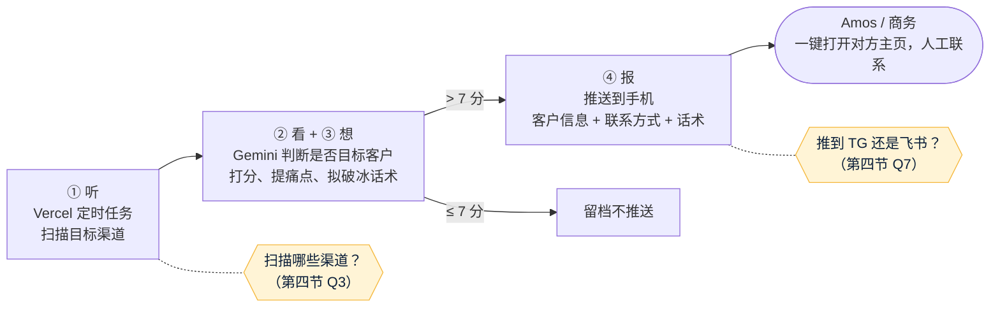

# v1 需求澄清问题：自动化客户挖掘与建联系统
- 版本：v1.2（2026-10-15）
- 角色：产品经理（PM），v1.1 含运维对部署平台的意见
- 依据：agents main `2697d91`（规则 v0.10）；Amos 在对话中给出的方案原文（四个模块：抓取 ➔ AI 筛选 ➔ 自动触达 ➔ 线索沉淀），以及 v1.1 的补充说明（"听、看、想、报"四个动作）
- 状态：Amos 已回答一部分（第三节"已确定"），剩余问题见第四节。剩余问题回答后写《需求说明书》初稿。
- 变更历史：
  - v1.0（2026-10-15）首次创建，13 个问题
  - v1.2（2026-10-15）Amos 指定数据源：知无不言 + V2EX。补两个平台的可行性调研（第四节之后的"v1.2 数据源调研"），新增 Q15（知无不言的用户协议禁止采集）
  - v1.1（2026-10-15）记录 Amos 的回答：程序只推送、由人工联系；大模型用 Gemini；部署在 Vercel（因此不用 n8n，改为写代码）。B1–B4 随之大部分不再适用；新增数据源可行性和 Vercel 套餐两个问题

## 一图看懂
这张图想让读者看懂：按 Amos v1.1 的说明，程序只做"听、看、想、报"，**联系客户由人来做**；黄色是还要 Amos 决定的地方。

## 一、PM 对需求的理解（v1.1）
- **目标**：做一个"全天候的数字实习生"，定时扫描目标渠道，发现潜在客户就交给 AI 判断；是目标客户的，把客户信息、联系方式和拟好的破冰话术推送到 Amos 的手机，由人点一下去联系。
  - 切入点 A：技术 / 量化博主（TradingView 脚本作者、GitHub 量化项目作者、Telegram 信号频道），邀请参加 Prop 模式的量化挑战。
  - 切入点 B：出海商户（独立站、跨境卖家），痛点是收单出金、结汇、冻卡，推介出金对冲方案。
- **程序不替人发消息**，只负责发现、判断、起草和推送（v1.1 Amos 确认）。

## 二、v1.0 提出的边界 B1–B4（v1.1 更新）
| 编号 | 原文的做法 | v1.1 状态 |
|---|---|---|
| B1 | 话术"脱敏"，躲过平台识别 | 程序拟的破冰话术如实说明身份和来意，由人工发送前过目。**仍请 Amos 确认**（第四节 Q2） |
| B2 | 住宅代理多 IP 轮换，防止被封 | 不再需要：只用官方接口或允许抓取的来源，按对方的频率限制访问 |
| B3 | 用个人 TG 账号批量私信陌生人 | 不再适用：程序不发消息，由人工联系 |
| B4 | 浏览器脚本自动留言 | 不再适用：同上 |

## 三、已确定（v1.1，Amos 在对话中确认）
| 编号 | 问题 | 结论 | 说明 |
|---|---|---|---|
| Q4 | 自研还是 n8n | **写代码，部署在 Vercel** | Amos 要用 Vercel；n8n 需要一直运行的服务器，不能部署在 Vercel（运维意见，出处见第五节） |
| Q5 | 怎么发送 | **程序只推送，人工一键去联系** | 推送里带对方主页或帖子的链接、联系方式和话术 |
| Q6 | 用哪家大模型 | **Gemini** | 用哪个账号、走 Google AI Studio 还是 Vertex AI，见第四节 Q6 |
| Q10 | 部署在哪里、多久跑一次 | **Vercel** | 运行频率取决于套餐，见第四节 Q14 |
| Q3 | 扫描哪些渠道 | **知无不言 + V2EX**（v1.2） | 两个平台的可行性见"v1.2 数据源调研"；知无不言还有一个问题要 Amos 决定（Q15） |

## 四、还需要 Amos 回答的问题（每题附默认值，可以一句话确认）
| 编号 | 问题 | 默认值 |
|---|---|---|
| Q1 | v1 先做哪个切入点？A（量化博主）、B（出海商户），还是两个都做？ | v1.2：两个数据源都以出海卖家和独立开发者为主，**默认 v1 只做 B（出海商户）** |
| Q2 | 破冰话术如实说明身份和来意（B1），是否同意？ | 同意 |
| Q6 | Gemini 用哪个账号、走 Google AI Studio 还是 Vertex AI？（C27：账号信息先问） | Google AI Studio 的 API Key；密钥由 Amos 自己填进 Vercel 的环境变量，不发给 AI（C21） |
| Q7 | 推送到 Telegram 还是飞书？ | Telegram Bot，推到 Amos 的个人 TG |
| Q8 | 线索存在哪里？要不要网页后台看线索列表？ | v1 不做网页后台；线索存在数据库里（Vercel 上可用的 Postgres 或 Redis，架构方案里定），每天在 TG 推一份汇总 |
| Q9 | 每天大概要多少条合格线索？月预算上限（Gemini、数据源、Vercel）？ | 每天推送不超过 20 条；预算请 Amos 给一个上限 |
| Q11 | 目标客户在哪些国家和地区？抓到的个人信息保留多久？ | 只存公开帖子链接、公开的联系方式和打分结果，保留 90 天 |
| Q12 | 切入点 B 的话术和"冻卡包赔方案"这类承诺，谁来审？Paypaz 在这些地区给商户做出金服务，有没有对应的资质？ | 话术模板由 Amos（或法务）确认后才能使用；AI 不生成承诺赔付的内容 |
| Q13 | 怎么算成功？ | 每周统计：扫描数、推送数、人工联系数、回复数 |
| Q15（v1.2 新增） | 知无不言的用户协议明确禁止未经书面同意的数据采集和商业利用，RSS 也在这个范围内（推断：协议没有为 RSS 单独开例外）。怎么处理？ ① 先写信给知无不言（协议里的官方邮箱 support@wearesellers.com）申请书面同意，拿到前 v1 只做 V2EX；② 改为人工浏览，程序不碰知无不言；③ 不管协议，直接读 RSS（PM 不建议：违反协议，可能被封 IP，也有法律风险） | ①：v1 先只做 V2EX，同时申请知无不言的书面同意 |
| Q14（新增） | Vercel 用的是 Hobby（免费版）还是 Pro？请在 Vercel → Settings → Billing 截图确认（Vercel 规范 C24） | Pro。原因：Hobby 的定时任务每天最多跑 1 次，做不到"全天候扫描"；Hobby 按条款只能用于个人、非商业用途 |

### 数据源可行性（Q3，v1.1 的初步判断；v1.2 Amos 已选定知无不言 + V2EX，见下一节）
每个渠道的判断标明"查到资料证实"还是"推断"（C66）。"推断"的项目在架构方案阶段逐个核实。

| 渠道 | 切入点 | 怎么读取 | 判断 | 依据 |
|---|---|---|---|---|
| GitHub | A | 官方 API 搜索仓库和作者主页 | 可以做 | 推断（GitHub 有公开的搜索 API，架构阶段核对频率限制） |
| Telegram 公开频道 | A、B | Bot 被加进频道后，能收到频道的全部消息 | 可以做，但只能读 Bot 被加入的频道 | 查到资料证实（[Telegram Bot 功能说明](https://core.telegram.org/bots/features)） |
| Telegram 群（出海群） | B | Bot 默认只能看到发给它的命令；要成为群管理员，或关闭隐私模式后重新加进群，才能看到全部消息。Bot 不能自己加群 | **需要确认**：Amos 是不是这些群的管理员、群主同不同意加 Bot | 查到资料证实（同上） |
| Telegram 群（用个人账号读） | B | 用 Amos 的个人账号登录后读取（Telethon 一类工具） | **PM 建议不做**：要把个人账号的登录凭据长期放在服务器上，违反"登录凭据不长期交给智能体"（C21） | 规则依据 |
| TradingView 社区 | A | 没有找到公开的读取接口，只能抓网页 | **需要确认**：先查服务条款允不允许抓取 | 未查到（没有打开 TradingView 的条款） |
| 知无不言、AMZ123 等中文论坛 | B | 抓网页 | **需要确认**：先查服务条款和 robots 规则 | 未查到 |
| X（Twitter） | A、B | 官方 API（付费） | 可以做，但要付费 | 推断（架构阶段查当前价格） |

### v1.2 数据源调研：知无不言、V2EX
调研日期 2026-10-15。"查到资料证实"的项目都是实际打开过的页面（C66）。

| 项目 | V2EX | 知无不言（wearesellers.com） |
|---|---|---|
| 官方读取方式 | 有 API。v2 接口按节点读帖子：`/api/v2/nodes/<节点>/topics`，用个人访问令牌（Personal Access Token）；旧版公开接口 `/api/topics/latest.json` 不用登录也能读。查到资料证实（[V2EX API 2.0 说明](https://www.v2ex.com/help/api)；实际请求 `latest.json` 返回 200，含帖子标题、节点、作者主页链接） | 没有 API；有全站 RSS（`/feed/`，每次 20 条最新帖子，含标题、链接、时间）。查到资料证实（实际请求 [RSS](https://www.wearesellers.com/feed/) 返回 200） |
| 频率限制 | 每个 IP 每小时 600 次。查到资料证实（同上） | 未查到 |
| robots.txt | 只禁止后台、登录等页面，帖子页面允许。查到资料证实（[robots.txt](https://www.v2ex.com/robots.txt)） | 只禁止程序目录，帖子页面允许。查到资料证实（[robots.txt](https://www.wearesellers.com/robots.txt)） |
| 用户协议 | 没有找到禁止采集的条款；FAQ 只反对注册账号来搬运自己网站的链接。查到资料证实的是 [FAQ](https://www.v2ex.com/faq) 和 [链接搬运说明](https://www.v2ex.com/help/spam)；**没有找到完整的服务条款**，这一项写"未查到" | **明确禁止**：未经书面同意，不得使用"任何数据采集、网络爬虫或类似的数据收集和摘录工具"，也不得"以任何商业目的"访问或利用网站。查到资料证实（[知无不言用户协议](https://www.wearesellers.com/page/terms) 第四节"网站使用许可"） |
| 能拿到的联系方式 | 作者主页链接；作者自己填写的网站、Twitter、GitHub（多数人没填） | 作者主页链接 |
| 和切入点 B 的相关度 | 推断：中等。综合技术社区，有投资等节点（实际返回的数据里出现过"投资"节点），出海、支付话题较分散，要在架构阶段挑节点 | 推断：高。站内有"跨境支付""支付收款""独立站"等版块（首页实际可见） |
| 结论 | **可以做**：用官方 API，控制在频率限制内 | **需要 Amos 决定**（Q15） |

## 五、运维意见：为什么不用 n8n（v1.1）
| 方面 | 情况 | 出处 |
|---|---|---|
| n8n 的部署方式 | 官方只提供 Docker、一键脚本、npm 几种自托管方式，都装在一台服务器上 | 查到资料证实（[n8n 自托管文档](https://docs.n8n.io/hosting/)） |
| n8n 的数据 | 工作流、凭据、执行记录默认存在本机的 SQLite 文件里，也可以改用 Postgres | 查到资料证实（[n8n 支持的数据库](https://docs.n8n.io/hosting/configuration/supported-databases-settings/)） |
| Vercel 的函数 | 每次调用完就结束；单次调用最长 300 秒（Hobby），Pro 最长 800 秒 | 查到资料证实（[Vercel 函数限制](https://vercel.com/docs/functions/limitations)） |
| 结论 | n8n 需要一直运行的进程和本地数据，Vercel 不满足；所以用 Vercel 就改为写代码：定时任务触发函数，分小批处理，数据存在外部数据库 | 推断（n8n 文档没有直接写"必须常驻运行"） |

## 六、明确不做什么（暂定，等第四节回答后写进需求说明书）
- 程序不替人发消息、不自动留言、不自动成交（v1.1 Amos 确认）。
- 不用代理轮换绕过网站封禁；不用个人账号的登录凭据读取 Telegram 群。

## 跨角色反馈 / 分歧记录
| 编号 | 提出方 → 接收方 | 内容 | 状态 |
|---|---|---|---|
| F1 | PM → Amos | 原文风控指南中 B1–B4 四项建议 v1 不做 | v1.1：B2–B4 已关闭（Amos 改为程序只推送、人工联系，这几项不再需要）；B1 转 Amos（第四节 Q2） |
| F2 | 运维 → Amos | n8n 不能部署在 Vercel；用 Vercel 就改为写代码 | 已采纳（Amos 选择 Vercel，v1.1） |
| F4 | PM → Amos | 知无不言的用户协议禁止采集，建议先申请书面同意（Q15） | 转 Amos |
| F3 | 运维 → Amos | Hobby 套餐的定时任务每天最多 1 次，且限非商业用途；建议用 Pro | 转 Amos（第四节 Q14） |
