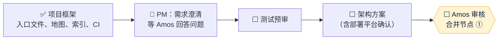

# 项目地图：auto-agent
- 用途：**新加入的人或大模型先读这一份**，10 分钟了解项目现在是什么样、代码在哪里、有哪些不能破坏的约定。要查具体的文件、接口、表、变量、历史问题，看《[项目索引](项目索引.md)》。
- 只写**当前状态**。按版本追加的文档（架构方案、技术方案）是当时的记录；和本文件不一致时，以本文件和代码为准。
- 版本：v0（2026-10-15，对应代码：还没有代码，只有项目框架）
- 依据：agents main `2697d91`（规则 v0.10）
- 维护：研发整合，各角色写自己的部分（C53）。**每次功能迭代，在同一个 PR 里更新本文件和《项目索引》**；`scripts/check-project-index.mjs` 在 CI 里检查索引（C54）。
- 变更历史：v0（2026-10-15）首次创建项目框架（入口文件、项目地图、项目索引、索引检查、CI）；v0.1（2026-10-15）Amos 给出方案原文，PM 写需求澄清问题；v0.2（2026-10-15）Amos 确认：程序只推送、人工联系，Gemini，Vercel

## 一图看懂
这张图想让读者看懂：项目现在走到了"首次创建项目"流程的哪一步。



## 1. 这个项目做什么
自动化客户挖掘与建联系统：从公开来源抓取潜在客户 → AI 筛选打分 → 起草并发出破冰消息 → 对方回复后通知 Amos 人工跟进。两个切入点：A 量化博主（Prop 模式）、B 出海商户（出金对冲）。已确定：程序只推送、由人工联系；大模型用 Gemini；部署在 Vercel（写代码，不用 n8n）。其余范围还在澄清，见 `需求文档/v1-需求澄清问题.md`。

| 业务 | 版本 | 使用者 | 页面 | 接口 | 数据 |
|---|---|---|---|---|---|
| 客户挖掘与建联 | v1（澄清中） | Amos、商务 | 待定 | 待定 | 待定 |

## 2. 代码怎么分层
还没有代码。代码目录和每个目录的归属角色在架构方案里约定（协作总则第三节）。目前的文件：

```
CLAUDE.md、AGENTS.md          — 编程智能体的入口
README.md                     — 简介
项目地图.md、项目索引.md        — 当前状态和索引（C53）
项目索引.config.json           — 索引检查的配置
scripts/check-project-index.mjs — 索引检查脚本（从 agents 仓库 工具/ 原样复制，不在这里修改）
.github/workflows/ci.yml      — 每个 PR 的自动检查（C54）
需求文档/v1-需求澄清问题.md     — PM 的澄清问题（等 Amos 回答）
```

以后按协作总则第三节增加：`00-架构方案.md`、`技术方案/`、`测试报告/`、`部署方案/`、`交付记录/`、`assets/`。

## 3. 环境
生产环境用 **Vercel**（v0.2 Amos 确认），按 agents 的 `平台规范/Vercel.md` 执行。套餐（Hobby 还是 Pro）还没有确认（C24）。

| 环境 | 分支 | 地址 | 数据 | 外部服务 |
|---|---|---|---|---|
| 本地 | 开发分支 | — | — | — |
| 测试环境 | `staging`（还没有建） | 待定 | 待定 | 待定 |
| 生产 | `main` | 待定 | 待定 | 待定 |

- CI：`.github/workflows/ci.yml`，目前只跑项目地图和索引检查。分支保护还没有开启（仓库是否公开、用什么套餐，先问 Amos，C27、C54）。

## 4. 关键流程在哪里
还没有代码。

| 流程 | 入口 | 核心代码 |
|---|---|---|

## 5. 不能破坏的约定
1. 密钥、密码不进仓库，也不经过 AI（C21）。
2. CI 不通过的 PR 不合并；不许为了变绿而跳过或删除测试（C54）。
3. `scripts/check-project-index.mjs` 不在本仓库修改，要改进就改 agents 仓库里的那一份再复制过来（C53）。

## 6. 常用命令
| 做什么 | 命令 |
|---|---|
| 安装 | 还没有 |
| 单元测试 | 还没有 |
| 项目地图和索引检查 | `node scripts/check-project-index.mjs` |
| 端到端测试 | 还没有 |
| 本地运行 | 还没有 |
| 看线上状态 | 还没有 |

## 7. 排查从哪里开始
还没有可运行的代码。CI 失败时，先看 PR 页面 Checks 里 `ci` 的输出：索引检查会逐条列出没写进索引的文件和不存在的路径。

## 8. 常见改动的检查清单
| 改动 | 要改的地方 |
|---|---|
| 新增任何文件 | 《项目索引》第 1 节加一行；新目录要加进 `项目索引.config.json` 的 `files.include` |

## 9. 冷启动问题清单
<!-- C53：每轮迭代结束时，让一个没看过项目的智能体只读 CLAUDE.md、本文件和《项目索引》回答下面的问题，答错或找不到的就补充文档。问题只增不删。有代码后补充真实的开发和排查问题 -->
1. 这个项目现在走到了流程的哪一步，下一步由哪个角色做什么？
2. 一个 PR 合并前要通过哪些自动检查？没通过时去哪里看原因？
